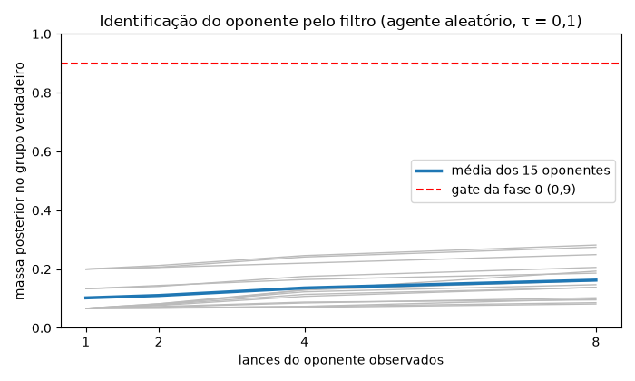

# Identificação do oponente pelo filtro (`inference_quality.png`)

## O que mostra

Massa posterior que o filtro bayesiano coloca no **grupo de comportamento verdadeiro** do oponente, em função do número de lances do oponente já observados. Cada linha cinza é um dos 15 oponentes do grid. A linha azul é a média dos 15. A linha vermelha tracejada é o gate da fase 0, em 0,9.

## Como foi calculado

- Fonte: `results/phase0_identification.csv`, gerado por `scripts/phase0_identification.py`.
- Agente que joga: aleatório, para isolar o que o filtro aprende só dos lances do oponente.
- 100 jogos por oponente, τ = 0,1 (o mesmo do treino). O filtro usa as 15 hipóteses do grid.
- Pontos medidos: após 1, 2, 4 e 8 lances. O eixo x não é linear por isso.
- O gate é atingido se a massa no grupo verdadeiro ≥ 0,9. A coluna `frac_pass_0.9` diz a fração de jogos que atingem isso.

## Valores

- Média dos 15 oponentes: cerca de **0,10 após 1 lance** e **0,16 após 8 lances**.
- Faixa após 8 lances: de 0,08 (oponentes 7 e 8) até 0,28 (oponente 1).
- Taxa de passagem do gate (massa ≥ 0,9): **0,00** para todos os oponentes em τ = 0,1.

## Como ler

- **Nenhuma linha se aproxima de 0,9.** O filtro não identifica o grupo verdadeiro em uma partida de até 8 lances, para nenhum oponente. Esse é o resultado que reprova o gate da fase 0 (TD-18).
- **Linhas separadas por nível:** a massa de cada grupo começa no prior (tamanho do grupo ÷ 15). Após 8 lances, os grupos de 3 oponentes (ids 1, 3 e 6) ficam entre 0,25 e 0,28; os pares (ids 2 e 5) entre 0,19 e 0,21; e os oponentes isolados entre 0,08 e 0,19.
- **O primeiro lance não muda nada:** após 1 lance, a massa de cada grupo fica igual ao seu prior (tamanho do grupo ÷ 15). Os lances iniciais do oponente são quase iguais para todos os oponentes, então não separam as hipóteses.
- **Ganho lento depois:** entre o lance 1 e o lance 8 a massa sobe de forma gradual. Essa evolução é a única informação que o filtro aproveita dentro de uma partida.

## Limitações

- O gráfico mostra só o agente aleatório. A identificação com a política do próprio agente pode ser diferente, porque as jogadas mudam quais colunas o oponente pode escolher.
- Os pontos de medição são 1, 2, 4 e 8 lances. Os valores entre eles são interpolados pelas linhas, não medidos.
- Os valores são para τ = 0,1. A fase 0 também testou τ = 0, 0,02 e 0,05, sem diferença qualitativa (TD-18).
