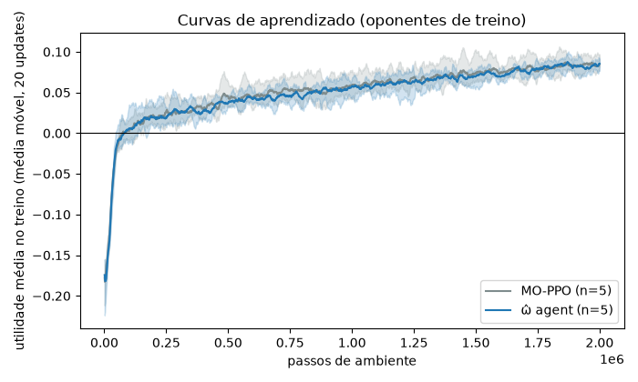

# Curvas de aprendizado (`learning_curves.png`)

## O que mostra

Utilidade média dos episódios de treino ao longo dos passos de ambiente, para o MO-PPO (cinza) e para o agente ω̂ (azul). Cada agente tem 5 seeds independentes, e a linha é a média entre seeds. A faixa sombreada vai do mínimo ao máximo entre os seeds daquele agente.

## Como foi calculado

- Fonte: `results/<agente>/seed<N>/train_log.csv`, coluna `mean_utility`, uma linha por update do PPO.
- Suavização: média móvel de 20 updates por seed, para reduzir o ruído dos episódios.
- Eixo x: `global_step`, até 2.000.000 passos (cada agente, cada seed).
- Utilidade = ω·R no fim do jogo, para o ω do próprio agente. Os oponentes são os do **treino**, não os do teste.

## Como ler

- **Início:** as duas curvas começam em cerca de −0,18 (média do primeiro update: −0,178 para o MO-PPO e −0,174 para o ω̂). Nessa fase o agente perde a maioria dos jogos.
- **Salto inicial:** antes de 100 mil passos as duas curvas cruzam zero. Esse é o aprendizado básico de jogar bem contra os oponentes.
- **Platô lento:** depois disso a utilidade sobe devagar, até cerca de +0,085 nos últimos 20 updates de cada agente (MO-PPO: 0,085; ω̂: 0,085).
- **Comparação:** as duas curvas estão praticamente sobrepostas do início ao fim. As faixas de seeds se misturam, então não há diferença de velocidade de aprendizado.
- **Entropia da política no fim:** 0,045 (MO-PPO) e 0,049 (ω̂). As duas políticas ficam quase determinísticas, o que é esperado com o learning rate do artigo (TD-15).

## Limitações

- Esta figura mostra os oponentes de treino. Ela não mede generalização. Para isso, veja `test_utility_by_opponent.png`.
- A utilidade de treino não é comparável diretamente com a de teste, porque os conjuntos de oponentes têm dificuldades diferentes.
