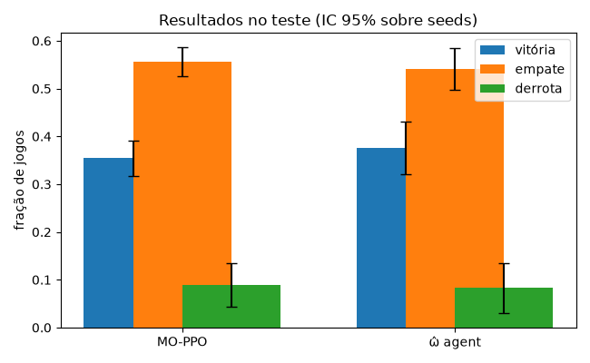

# Resultados no teste: vitória, empate e derrota (`test_outcome_rates.png`)

## O que mostra

Fração de jogos vencidos, empatados e perdidos no conjunto de teste, para o MO-PPO e para o agente ω̂. As barras de erro são o IC de 95% sobre os 5 seeds.

## Como foi calculado

- Fonte: `results/mo_ppo/eval_test.csv` e `results/belief/eval_test.csv`.
- Cada célula tem 100 jogos. A taxa de cada agente é a média das células, e o IC é calculado sobre os 5 seeds.
- As três taxas somam 1 em cada jogo. Empate inclui jogos sem vencedor.

## Valores

| Resultado | MO-PPO | ω̂ agente |
|---|---|---|
| Vitória | 0,355 ± 0,037 | 0,376 ± 0,055 |
| Empate | 0,556 ± 0,031 | 0,541 ± 0,043 |
| Derrota | 0,089 ± 0,045 | 0,083 ± 0,053 |

## Como ler

- **Empate é a maioria dos jogos para os dois agentes** (cerca de 55%). Isso é esperado para o 4×4: o tabuleiro é pequeno e os oponentes são fortes.
- O ω̂ vence um pouco mais (0,376 contra 0,355) e perde um pouco menos (0,083 contra 0,089). As diferenças são menores que o IC, então **não são estatisticamente distinguíveis**.
- Os dois agentes têm derrotas raras (menos de 10% dos jogos), e a faixa de derrota é semelhante.

## Limitações

- A barra de erro é entre seeds, não entre jogos. Ela mede a variação de treino, não o acaso do jogo.
- Os resultados são só do conjunto de teste (3 oponentes). Não generalizam para outros oponentes sem novo teste.
