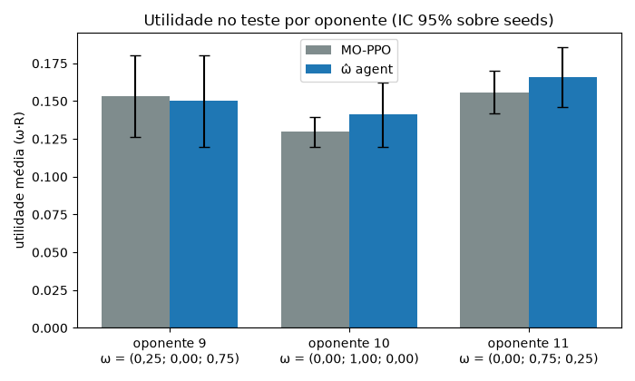

# Utilidade no teste por oponente (`test_utility_by_opponent.png`)

## O que mostra

Utilidade média (ω·R) do MO-PPO (cinza) e do agente ω̂ (azul) contra cada um dos três oponentes do **conjunto de teste** (ids 9, 10 e 11). As barras de erro são o IC de 95% sobre os 5 seeds.

## Como foi calculado

- Fonte: `results/mo_ppo/eval_test.csv` e `results/belief/eval_test.csv`.
- Cada seed é avaliado em todas as células: 15 ω próprios × 3 oponentes × 2 lados × 100 jogos, com política gulosa.
- Dentro de cada seed, a utilidade é média sobre ω próprio e lados. O IC é calculado sobre essas médias por seed (t de Student, n = 5), pela função `summarize` do harness compartilhado.

## Valores

| Oponente | ω (vencer; vencer rápido; colunas) | MO-PPO | ω̂ agente | Diferença (ω̂ − MO-PPO) |
|---|---|---|---|---|
| 9 | (0,25; 0; 0,75) | 0,153 ± 0,027 | 0,150 ± 0,030 | −0,003 |
| 10 | (0; 1; 0) | 0,130 ± 0,010 | 0,141 ± 0,021 | +0,012 |
| 11 | (0; 0,75; 0,25) | 0,156 ± 0,014 | 0,166 ± 0,020 | +0,010 |

Quem são esses oponentes, e por que eles diferem, está em [test_opponents.md](test_opponents.md).

Média geral no teste: MO-PPO +0,146 ± 0,014; ω̂ +0,152 ± 0,013.

## Como ler

- O ω̂ fica um pouco acima do MO-PPO nos oponentes 10 e 11, e um pouco abaixo no 9.
- **Nenhuma diferença está fora do intervalo de confiança.** Os intervalos de cada agente se sobrepõem em todos os três oponentes.
- O oponente 10 é o mais difícil para os dois agentes (utilidade mais baixa). Os oponentes 9 e 11 ficam mais altos.
- Interpretação: nesta versão, o ω̂ não ganha de forma consistente sobre o MO-PPO. A direção da diferença muda de oponente para oponente.

## Limitações

- Com n = 5 seeds, o IC é largo. Um efeito de +0,01 não é detectável com esse número de seeds.
- O filtro usa só os oponentes de treino como hipóteses (TD-19). Os oponentes 9, 10 e 11 nunca estão no suporte do filtro, então o agente ω̂ não consegue representar corretamente o oponente que enfrenta.
