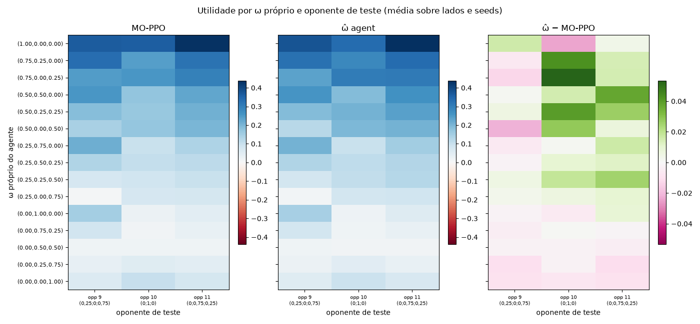

# Utilidade por ω próprio e oponente de teste (`utility_heatmaps.png`)

## O que mostra

Três mapas de calor com a mesma grade: linhas são os 15 valores do ω próprio do agente (ω = (vencer, vencer rápido, controle de colunas)), colunas são os 3 oponentes de teste, com o ω de cada um embaixo do nome. O perfil de cada oponente está em [test_opponents.md](test_opponents.md).

1. **MO-PPO:** utilidade média em cada célula.
2. **ω̂ agente:** utilidade média em cada célula.
3. **ω̂ − MO-PPO:** diferença entre os dois. Verde significa que o ω̂ é melhor; rosa, que é pior.

Os dois primeiros usam a mesma escala de cores (azul = utilidade positiva, vermelho = negativa). O terceiro tem escala própria, centrada em zero.

## Como foi calculado

- Fonte: as mesmas duas CSVs de avaliação de teste.
- Cada célula é a média de `mean_utility` sobre os lados (X e O) e os 5 seeds. Cada seed já é uma média de 100 jogos.
- A diferença é calculada célula a célula, sobre essas médias.

## Como ler

- **Padrão do MO-PPO e do ω̂:** os dois mapas são muito parecidos. A utilidade cai da linha de cima (ω próprio = (1, 0, 0), só vencer) para a de baixo (ω próprio = (0, 0, 1), só controle de colunas). Quando o agente se importa só com vencer, ele ganha mais.
- **Mapa de diferença:** a escala vai de −0,024 a +0,053. Das 45 células, 26 são positivas (ω̂ melhor) e 19 são negativas.
- Os maiores ganhos do ω̂ estão no oponente 10, nas linhas de ω próprio (0,75, 0,00, 0,25) e (0,75, 0,25, 0,00). A pior célula (−0,024) é a do oponente 10 com ω próprio (1, 0, 0).

## Limitações

- **As células da diferença não têm IC próprio.** Cada célula é uma média de 5 seeds, e a variação entre seeds é da mesma ordem de grandeza que a diferença. Não dá para afirmar que um ganho de +0,05 em uma célula é real.
- Com 26 de 45 células positivas, o resultado é levemente favorável ao ω̂, mas sem evidência estatística forte. A leitura correta é "não há padrão sistemático".
- A grade só tem os 15 pontos do simplex, então os valores entre eles não estão cobertos.
