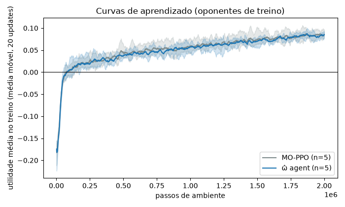
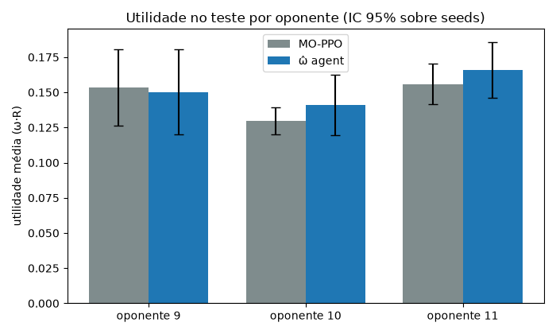

<!-- _class: lead -->

# Inferência de preferências do oponente em ambientes multiobjetivo e multiagente com soma zero.

Anderson Gonçalves, Diogo Rezende, Luiz Felipe e João Augusto · 27/11/2026

---

## Problema

- Em jogos multiobjetivo, cada jogador pondera objetivos por um vetor de preferências $\omega$.
- A modelagem de oponentes existente prevê a **próxima ação** do oponente.
- Este projeto tenta inferir **a preferência $\hat{\omega}$ do oponente** a partir dos seus lances e condiciona a política do agente em ($\omega, \hat{\omega}$).

[Artigo base](https://openreview.net/pdf?id=UW4K5qTUfA): *Opponent Modelling for Multi-Objective Multi-Agent Reinforcement Learning in Sequential Settings (2026; Obiang, Rădulescu)*

---

## Hipótese (H1)

Contra oponentes com $\omega$ **não vistos no treino**, um agente que infere $\hat{\omega}$ tem utilidade maior do que o MO-PPO sem modelo de oponente.

Ordem esperada:
- melhor resposta exata ≥ oráculo ≥ agente $\hat{\omega}$ ≥ MO-PPO

---

## Ambiente, preferências e oponentes

No MO-Connect4, dois jogadores alternam peças em um tabuleiro 4×4 e tentam fazer quatro em linha. Cada jogador avalia o resultado por três objetivos: vencer, vencer rápido e controlar colunas.

A preferência de um jogador é um vetor ω = (ω₁, ω₂, ω₃) de pesos não negativos que somam 1. Os vetores possíveis formam um triângulo, o **simplex**, cujos vértices são os objetivos puros: (1, 0, 0), (0, 1, 0) e (0, 0, 1).

Usamos 15 pontos desse triângulo, espaçados de 0,25. Cada ponto define um oponente, que joga segundo a política $\mathrm{softmax}(Q_k / \tau)$, calculada de forma exata. Com τ = 0,1, ele quase sempre escolhe o melhor lance, mas comete erros ocasionais.

Animação do ambiente MO-Connect4, da documentação do MOMAland (momaland.farama.org).

---

## Baseline: MO-PPO

- Política MLP *actor-critic* com máscara de ações; entrada = tabuleiro + ω próprio.
- Hiperparâmetros do Apêndice A do artigo base; 5 seeds × 2M passos.
- Avaliação no **split de teste** (3 oponentes, 15 ω próprios, dois lados, 100 jogos por célula).

| Agente | Utilidade média | Vitória | Empate | Derrota |
|---|---|---|---|---|
| Aleatório | −0,134 | 0,098 | 0,462 | 0,440 |
| MO-PPO | +0,146 ± 0,014 | 0,355 ± 0,037 | 0,556 ± 0,031 | 0,089 ± 0,045 |

IC 95% sobre 5 seeds.

---

## Agente $\hat{\omega}$: filtro bayesiano

$$
P(k \mid h_t) \propto P(k)\prod_{i \le t} \mathrm{softmax}!\left(Q_k(s_i, \cdot)/\tau\right)_{a^{opp}_i}
$$

Estima, a partir dos lances observados, qual dos 15 oponentes está jogando. 

**Como se comporta:** começa com a mesma probabilidade para todos e, a cada lance do oponente, multiplica o peso de cada hipótese pela probabilidade que aquele oponente daria ao lance observado; assim, as hipóteses que explicam os lances ganham peso e as demais perdem.

- Hipóteses: os 15 índices do grid (não grupos, porque com τ > 0 ω's do mesmo grupo diferem).
- Atualização em log-espaço, a cada lance do oponente.
- Entrada da política: tabuleiro + ω próprio + probabilidade de ser oponente **k**.

---

## Resultado: agente $\hat{\omega}$ vs MO-PPO (teste)

| Agente | Utilidade média | Vitória | Empate | Derrota |
|---|---|---|---|---|
| MO-PPO | +0,146 ± 0,014 | 0,355 ± 0,037 | 0,556 ± 0,031 | 0,089 ± 0,045 |
| $\hat{\omega}$ | +0,152 ± 0,013 | 0,376 ± 0,055 | 0,541 ± 0,043 | 0,083 ± 0,053 |

- Hipótese **não** está confirmada.

---

## Curvas de treinamento

Os dois agentes começam em cerca de −0,18 de utilidade média e chegam a cerca de +0,085 após 2 milhões de passos. As curvas se sobrepõem durante todo o treino, e a faixa entre os seeds é parecida nos dois casos.

Ou seja, o agente $\hat{\omega}$ aprende no mesmo ritmo que o MO-PPO. A informação do filtro não acelera o treino nem muda o nível final, nos oponentes de treino.

---

## Oponentes de teste: quem são

| Oponente | ω (vencer; vencer rápido; colunas) | Perfil | Oponente de treino mais parecido |
|---|---|---|---|
| 9 | (0,25; 0; 0,75) | sobretudo controle de colunas | 8 (distância 0,03) |
| 10 | (0; 1; 0) | apenas vencer rápido | 12 (distância 0,09) |
| 11 | (0; 0,75; 0,25) | sobretudo vencer rápido | 12 (distância 0,05) |

Os três são diferentes entre si. Os oponentes 10 e 11 são os mais parecidos (distância 0,05),já o 9 é o mais distante dos dois (distância 0,12).

Distância: variação total entre as políticas de lance dos dois oponentes (0 = iguais, 1 = totalmente diferentes), média sobre as posições do jogo, com τ = 0,1.

---

## Desempenho por oponente de teste

Contra o oponente 10, o agente ω̂ fica acima do MO-PPO (+0,012). Contra o 11, também (+0,010). Contra o 9, fica ligeiramente abaixo (−0,003).

Nenhuma dessas diferenças sai do intervalo de confiança de 95% sobre os 5 seeds, então não há ganho consistente. O oponente 10 é o mais difícil para os dois agentes.

---

## Por que o filtro não ajuda: teste de identificação (fase 0)

Para saber se o problema estava nos lances, medimos o filtro sozinho. 

Um agente aleatório jogou 100 partidas contra cada um dos 15 oponentes, e registramos quanta probabilidade o filtro dava ao grupo verdadeiro depois de cada lance. 

Em média, essa probabilidade vai de 0,10 após o primeiro lance para 0,16 após o oitavo: o filtro aprende, mas muito devagar.

O critério de aprovação era chegar a 0,9, mas nenhum oponente chega perto: após oito lances, a probabilidade fica entre 0,08 e 0,28, e nenhuma partida passa do limiar com τ = 0,1. Em um tabuleiro 4×4, portanto, os lances do oponente não revelam a sua preferência, e trocar τ não muda isso.

Isso explica o resultado do slide anterior. A crença que chega à política traz pouca informação, então o agente ω̂ se comporta quase como o MO-PPO.

---

## Limitações

A limitação mais importante é que, no teste, o filtro conhece apenas os oponentes de treino. 

O oponente verdadeiro nunca faz parte das hipóteses, então o agente $\hat{\omega}$ é avaliado com um modelo que não contém justamente o que deveria identificar. 

Uma versão com o grid completo ainda precisa ser rodada para comparar.

Por fim, o MO-PPO apareceu com 0,366 de vitória na primeira rodada e com 0,355 na repetição. As duas estão registradas, e a diferença fica dentro do intervalo de confiança.

---

## Próximos passos

1. Mudar a observação ou o horizonte.
2. Rodar a sensibilidade com o grid completo como hipótese.
3. Calibrar τ e implementar a melhor resposta exata com regret.
4. Agente oráculo (TD-04) e métrica de erro de ω̂ por lance.
5. Figuras, tabela final e texto do paper.

---

<!-- _class: lead -->

# Obrigado
